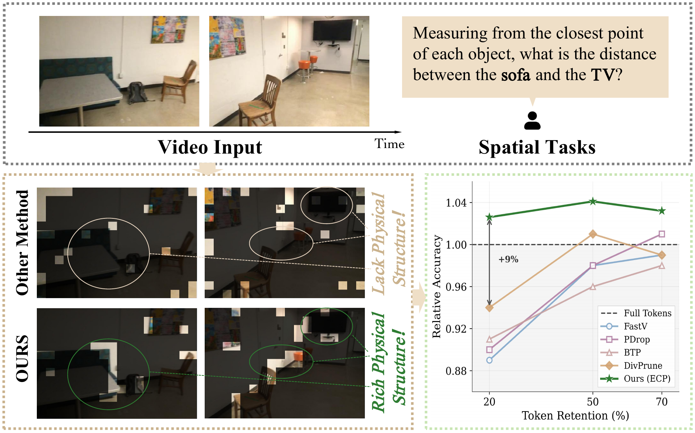
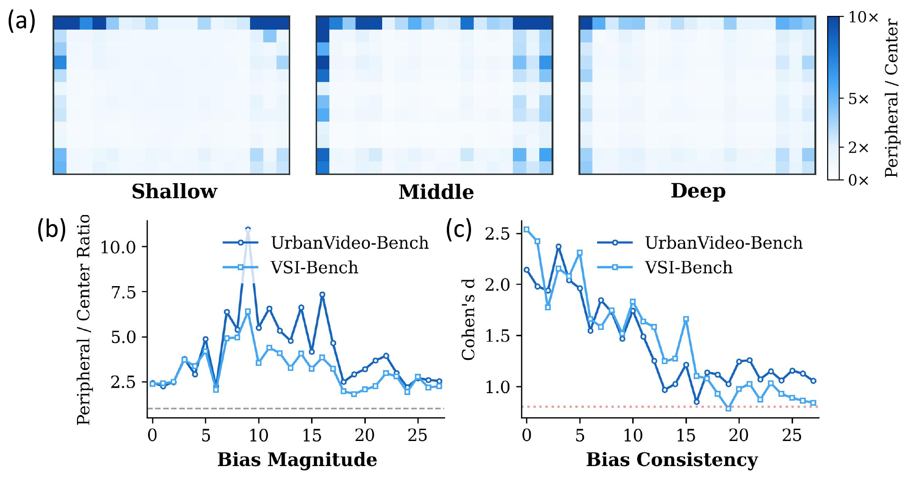
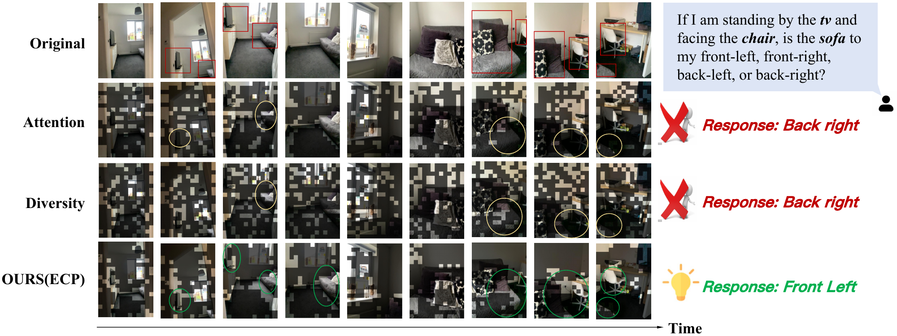

<h1 align="center">✂️ EventPrune</h1>

<p align="center">
  <strong>Cascaded Event-Assisted Token Pruning<br>
  for Efficient Embodied Spatial Reasoning</strong>
</p>

<p align="center"><strong>NeurIPS 2026</strong></p>

<p align="center">
  <a href="https://arxiv.org/abs/2605.19506"></a>
  <a href="https://ma-potter.github.io/pengtaoma00.github.io/eventprune/"></a>
  <a href="https://huggingface.co/datasets/Ma-Potter/ESR-Real"></a>
</p>

Event Cascade Pruning (ECP) uses event data to guide temporal sampling, motion saliency filtering, and attention–event rank fusion. This repository provides the ESR-Real evaluation script, the customized Qwen2.5-VL implementation, and its visual processing tools.

<p align="center">
  <a href="assets/overview.png"></a>
</p>

<p align="center">
  <sub>Event guidance preserves task-relevant geometry under token compression.</sub>
</p>

## Installation

Use Python 3.10 and a CUDA GPU. Run the following commands from the repository root:

```bash
conda create -n eventprune python=3.10 -y
conda activate eventprune
python -m pip install -r requirements.txt
python -m pip install flash-attn==2.7.4.post1 --no-build-isolation
```

Prepare a local Qwen2.5-VL-7B-Instruct checkpoint. The customized `qwen_vl_utils` module is included in this repository.

## Data preparation

Download [ESR-Real](https://huggingface.co/datasets/Ma-Potter/ESR-Real) manually. It contains RGB videos, corresponding event data, and spatial QA annotations. Keep this layout:

```text
ESR-Real/
  test.jsonl
  videos/
    VIDEO_ID.mp4
  event/
    VIDEO_ID/
      *.pt
```

## Evaluation

Replace the model and data paths below with your local paths:

```bash
CUDA_VISIBLE_DEVICES=0 python esrbench.py \
  --ckpt_path /path/to/Qwen2.5-VL-7B-Instruct \
  --task_jsonl /path/to/ESR-Real/test.jsonl \
  --video_dir /path/to/ESR-Real/videos \
  --event_voxel_dir /path/to/ESR-Real/event \
  --result_dir outputs/esr_20 \
  --run_name esr_20_ECP \
  --num_fixed_frames 64 \
  --sampling_mode fixed_frames \
  --sampling_strategy ets \
  --ets_threshold 0.1 \
  --fps 1 \
  --emsf_drop_fraction 0.3 \
  --pruning_config_file configs/esr_20.json \
  --use_earf
```

## Visual analysis

### Peripheral attention bias

Attention maps and layer-wise statistics reveal peripheral attention bias, motivating event-assisted calibration.

<p align="center">
  <a href="assets/attention_bias.png"></a>
</p>

### Retained-token visualization

At high compression, ECP retains more continuous object contours in this spatial reasoning example.

<p align="center">
  <a href="assets/token_pruning.png"></a>
</p>

## License

Code is licensed under Apache-2.0; upstream notices are retained in [NOTICE](NOTICE) and the source files. ESR-Real data is separately licensed under [CC BY-NC 4.0](https://creativecommons.org/licenses/by-nc/4.0/).

## Citation

If you use our code or dataset in your research, please cite our paper:

```bibtex
@misc{ma2026eventprunecascadedeventassistedtoken,
  title={EventPrune: Cascaded Event-Assisted Token Pruning for Efficient First-Person Dynamic Spatial Reasoning},
  author={Pengtao Ma and Ziliang Zhou and Ciyu Ruan and Haoyang Wang and Kaiyuan Li and Zihang Gong and Wenhua Ding and Chen Gao and Jingao Xu and Xinlei Chen},
  year={2026},
  eprint={2605.19506},
  archivePrefix={arXiv},
  primaryClass={cs.CV},
  url={https://arxiv.org/abs/2605.19506},
}
```
